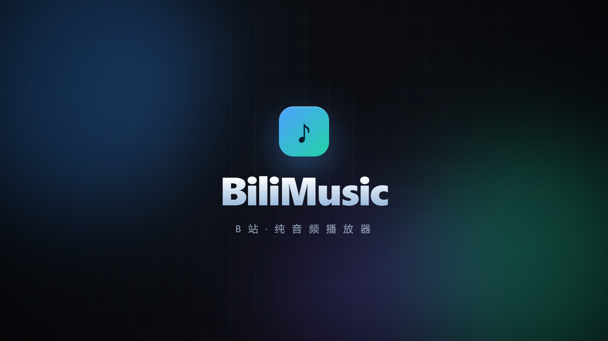
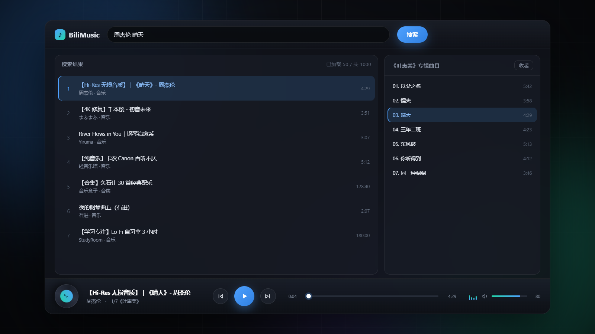
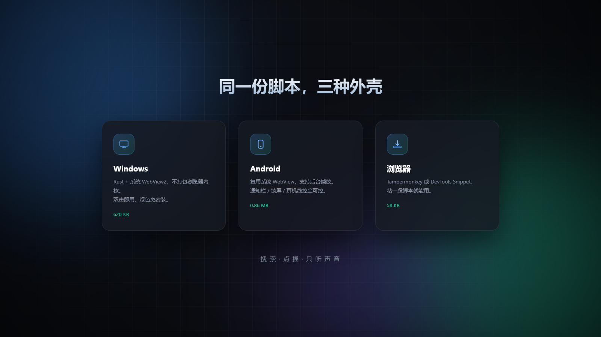
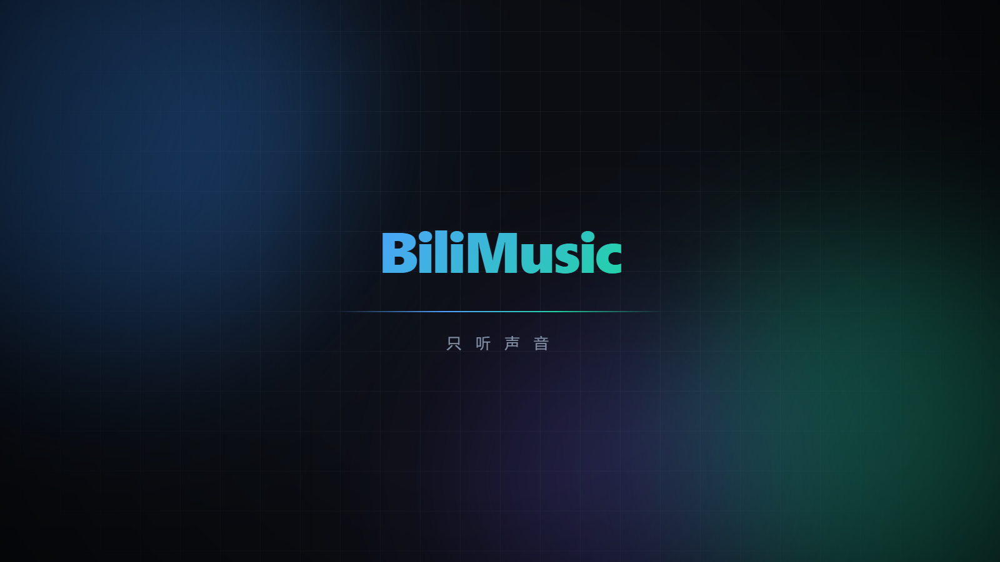

<div align="center">



# BiliMusic

**把 B站变成一个纯音频播放器 —— 搜索、点播、只听声音，不看视频。**

同一份脚本，三种外壳：Windows 桌面 / Android 手机 / 浏览器注入。

</div>

---

## 这是什么

打开 B站，页面被清空，只剩一个深色极简播放器。输入关键词搜歌，点一下就开始播——**只拉取 dash 音频流，完全不下载视频**。

适合当背景音乐 / 学习 BGM / 听 B站 上的纯音乐和歌单。

<div align="center">

</div>

## 功能

| | |
|---|---|
| 🔍 **搜索** | 走 B站官方搜索接口，一次 50 条，滑到底自动翻页（最多约 1000 条） |
| 🎵 **纯音频** | 取 `dash.audio[]`，最高 192K，**零视频流量** |
| ▶️ **点播** | 点列表任意一条即播；合集自动定位到你点的那一集 |
| ⏮⏭ **上下曲** | 合集 / 多分P 才有；单视频时按钮自动置灰 |
| 🔊 **音量** | 播放器内音量（与系统音量无关），记忆上次数值 |
| ⏱ **进度** | 拖动任意定位，实时显示当前 / 总时长 |
| 🔁 **循环** | 单曲循环开关 |
| 📋 **播放队列** | 右侧显示合集 / 分P 列表，点击直达 |
| 🚫 **零干扰** | B站页面全部隐藏；登录弹窗、广告位实时清除 |
| ⌨️ **快捷键** | `空格` 播放暂停，`Ctrl+←/→` 上一曲/下一曲 |
| 📱 **后台播放** | Android 端切后台、锁屏不中断，通知栏 / 耳机线控可控 |

<div align="center">

</div>

## 下载

| 版本 | 说明 | 体积 |
|---|---|---|
| **三合一** | 电脑 + 手机 + JS 打包 | [123 云盘](https://1833191093.share.123pan.cn/123pan/flz3Td-c1byA) |
| **电脑版** | `BiliMusic.exe` + `WebView2Loader.dll` | [123 云盘](https://1833191093.share.123pan.cn/123pan/flz3Td-8dfyA) · 620 KB |
| **手机版** | `BiliMusic.apk`（Android 7.0+） | [123 云盘](https://1833191093.share.123pan.cn/123pan/flz3Td-qmpqA) · 0.86 MB |
| **JS 脚本** | 给油猴 / DevTools 用 | [123 云盘](https://1833191093.share.123pan.cn/123pan/flz3Td-zt76A) · 58 KB |

## 怎么用

### 电脑版（推荐）

双击 `BiliMusic.exe` 就行。它靠系统自带的 **WebView2 Runtime**（Win10/11 一般随 Edge 自带），不打包浏览器内核，所以本体只有 620 KB。

> 极少数没装 WebView2 的机器会弹框提示，装一下 Evergreen Runtime 即可。

### 手机版

把 `BiliMusic.apk` 传到手机安装（需允许「安装未知来源应用」）。

> 装上没声音的话，去应用商店把 **Android System WebView** 更新到最新。

### 浏览器注入

**Tampermonkey**：新建脚本 → 粘贴 `bili-music.js` 全文 → 保存 → 打开 B站 任意页面即生效。

**DevTools Snippet**：`F12` → Sources → Snippets → 新建 → 粘贴 → `Ctrl+Enter` 运行。

## 从源码构建

```bash
# 电脑版（需要 Rust 工具链）
构建exe.bat
# 等价于：cd rs && cargo build --release

# 手机版（需要 JDK 17+ 和 Android SDK）
构建apk.bat
# 等价于：gradle -p android assembleDebug
```

两个 bat 都会自动定位工具链，产物分别是 `BiliMusic.exe` 和 `BiliMusic.apk`。

## 项目结构

```
bili-music.js          ← 核心：整个播放器（三端共用这一份）
rs/                    ← Windows 外壳（Rust + wry + WebView2）
android/               ← Android 外壳（Kotlin + WebView + 前台服务）
demo/                  ← 宣传片：HTML 演示页 + 逐帧渲染脚本
tools/                 ← 图标生成
```

`bili-music.js` 是唯一的真相来源。桌面版用 `include_str!` 编译期内嵌，安卓版由 Gradle 拷贝进 assets——**改一次，三端同步**。

## 技术笔记（踩过的坑）

这些是方案能跑起来的关键，改代码时很容易踩回去，记在这里。

### 播放必须走 MSE，不能直接喂 `<audio>`

B站的 `.m4s` 是 `iso5` brand 的分片 fMP4，直接交给 `<audio src=...>` 或 Blob 都会 `DEMUXER_ERROR / error 4`，只有 MediaSource 能解。

- SourceBuffer 的 MIME 必须和 B站播放器一字不差：`audio/mp4;codecs="mp4a.40.5"`（**无空格**）
- **`play()` 之前绝不能 `endOfStream()`**，否则必报 `NotSupportedError`
- 首次预取要小（384 KB）：等太久会让「用户手势」过期
- 切歌要**换一个全新的 `Audio` 对象**，同一元素 `load()` 再挂 MediaSource 会让 SourceBuffer detach
- 别设 `crossOrigin='anonymous'`、别设 `referrerPolicy='no-referrer'`

### 桌面和安卓的 MIME 是反的

| 平台 | 30280 该用的 MIME |
|---|---|
| 桌面 WebView2 / Chrome | `mp4a.40.5`（API 报的是 40.2，用它 append 不报错但**解不出声**） |
| Android WebView | 接口给的真实 codecs（40.2） |

所以代码里按平台分流，两边各走各的首选项，其余作为兜底。

### Android 的 UA 必须伪装成桌面 Chrome

WebView 默认 UA 带 `Android ... wv`，B站会把 `www.bilibili.com` **302 到 `m.bilibili.com`**；落地页一变，`playurl` 返回的音频就从 `edge.mountaintoys.cn:4483` 改成 `mcdn.bilivideo.cn:8082` 这类 P2P 节点，在模拟器 / 部分网络下取不到数据 → 「全部线路失败」。

### 别拿 `isTypeSupported()` 当门槛

Android WebView 对 AAC 的 `MediaSource.isTypeSupported()` 经常误报 `false`。信了它就会放弃 MSE 去走原生 `<audio>`，而 B站的 fMP4 原生元素必然失败。正确做法是只要存在 `MediaSource` 就尝试，以 `addSourceBuffer` 的实际结果为准。

### 调试媒体播放，用 `decodeAudioData()` 判真

`MediaSource.isTypeSupported()` 和 `mediaCapabilities.decodingInfo()` 都可能骗你（VS Code 内嵌的 Electron 两个都报支持，实际没解码器）。**只有 `decodeAudioData()` 抛 `EncodingError` 才是真的不能解。**

### 通知栏控制（Android 13+）

- 音频在 WebView、按钮在原生，中间靠 `PlayerBridge` 单例转发
- **13+ 的通知按钮由 `PlaybackState.actions` 决定**，`MediaStyle.setShowActionsInCompactView()` 会被忽略——两边都要设
- 通知固定 `setOnlyAlertOnce(true)`，否则进度更新会反复响铃

## 宣传片

`demo/showcase.html` 是一个可以自己打开的演示页（按 `R` 重播、`H` 隐藏控件）。

`demo/record.py` 能把它**逐帧渲染**成 mp4（不是录屏）：页面在 `?rec=1` 下由 `window.__rec.seek(t)` 决定每一帧，脚本截图后管道喂给 ffmpeg，所以不丢帧、帧率精确。

```bash
python demo/record.py --bgm demo/bgm.wav    # 1080p60 + 程序合成的背景音乐
python demo/make_bgm.py                     # 生成那段 BGM（纯合成，无版权素材）
```

<div align="center">

</div>

## 已知限制

- 播放依赖浏览器有 AAC 解码器（WebView2 / Chrome / Edge / 系统 WebView 都有）
- 未登录也能搜和播，但心跳上报需要登录 Cookie 才会记录播放进度
- 不下载视频流，所以没有画面——这是设计目标，不是缺陷

## 说明

- 本项目是第三方客户端，与哔哩哔哩官方无关
- 仅供学习与技术交流，请勿用于商业用途；接口与内容版权归哔哩哔哩及原作者所有
- 请合理使用，不要给 B站 服务器造成压力

## 致谢

- [wry](https://github.com/tauri-apps/wry) / [tao](https://github.com/tauri-apps/tao) —— 桌面端 WebView 外壳
- 宣传片与部分代码由 **DeepSeek** AI 辅助完成

## License

[MIT](LICENSE)
